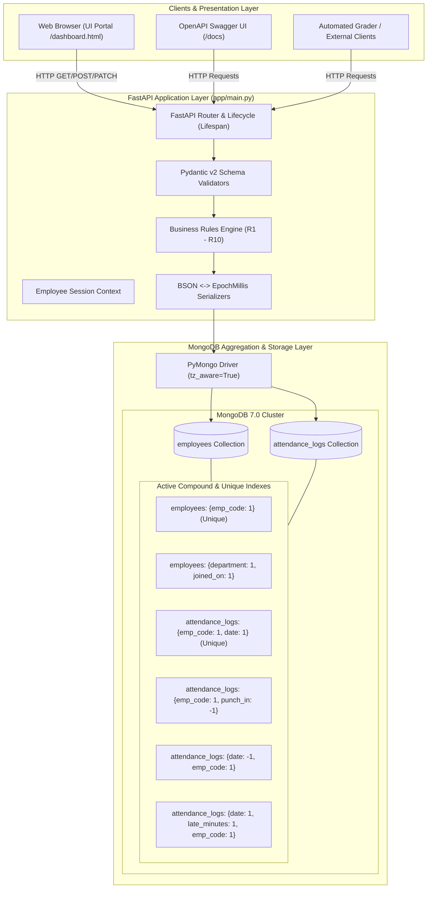
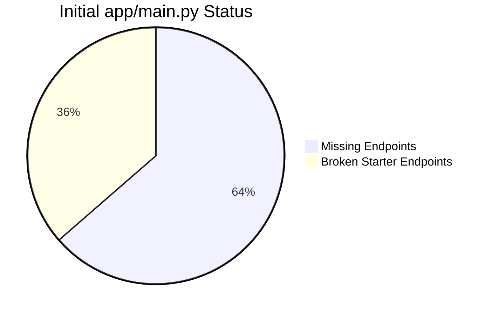
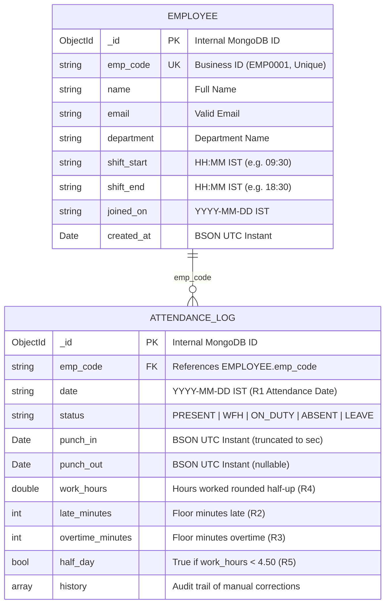
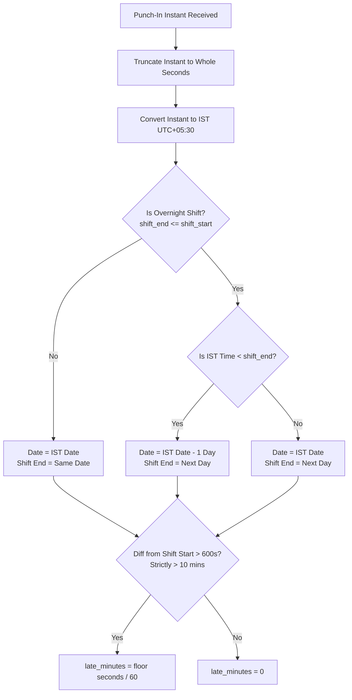
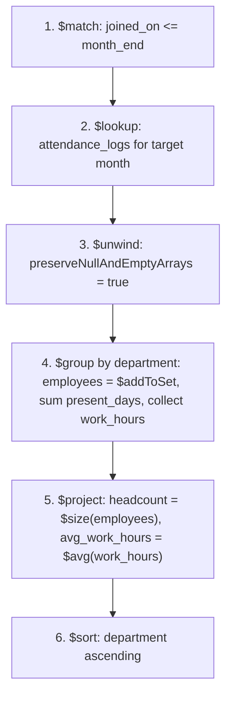
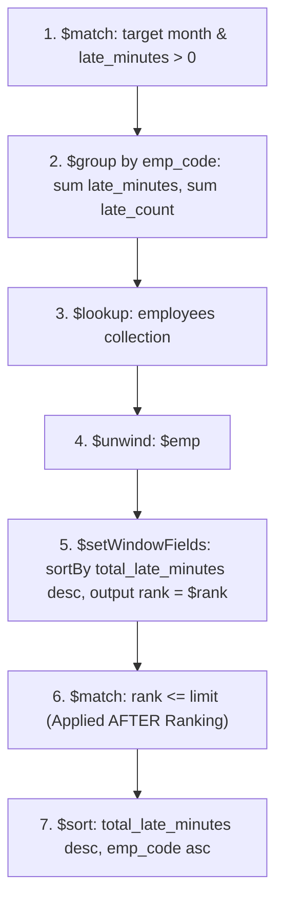
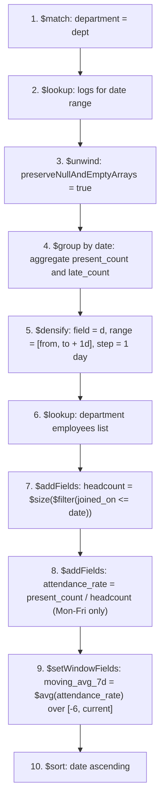
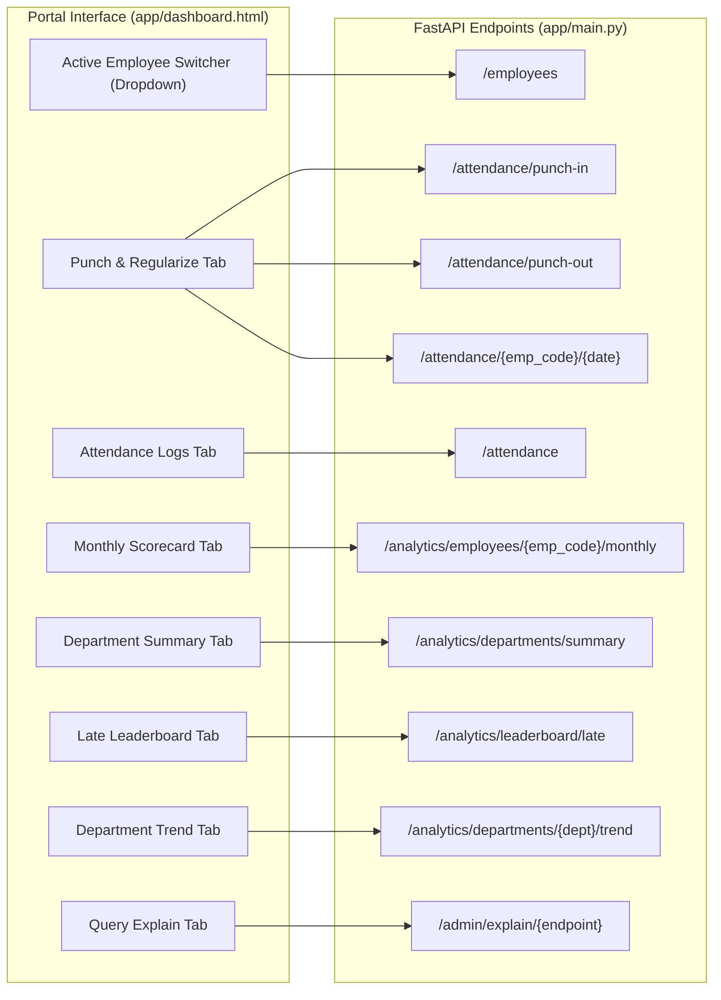

# Solution Architecture: Employee Attendance & Analytics System

## 1. Executive Summary

This document provides the definitive solution architecture, system design, data models, aggregation pipelines, and concurrency controls for the **Employee Attendance & Analytics API**. The application is implemented as a production-ready **FastAPI** service backed by **MongoDB 7.0**, fulfilling all business rules (R1–R10) and performance guarantees specified in the assignment contract.

---

## 2. High-Level Architecture Overview

The system architecture follows a clean, single-tier microservice model with a persistent data layer in MongoDB. It serves both human operators via an interactive web portal and external systems via standard RESTful APIs.



---

## 3. Environment & Infrastructure Setup

### 3.1 Python Runtime & Virtual Environment
- **Runtime:** Python 3.14.7 (macOS arm64).
- **Virtual Environment Path:** `.venv/`
- **Installed Packages:**
  - `fastapi>=0.110` (Web routing, exception handling, OpenAPI generator)
  - `uvicorn[standard]>=0.29` (High-performance ASGI server)
  - `pymongo[srv]>=4.7` (MongoDB client with DNS SRV resolution)
  - `pydantic>=2.6` (Strict schema and regex validation)
  - `python-dotenv>=1.0` (Environment configuration loader)
  - `pytest>=9.1` & `httpx>=0.28` (Test framework & in-process TestClient)

### 3.2 MongoDB 7.0 Community Setup
- **Formula:** `mongodb/brew/mongodb-community@7.0` (v7.0.45) installed via Homebrew.
- **Service Management:** `brew services start mongodb/brew/mongodb-community@7.0`
- **Connection Configuration:**
  - Connection URI: `mongodb://localhost:27017` (configurable via `MONGO_URI`)
  - Target Database: `attendance_db` (configurable via `MONGO_DB`)
  - Timezone Mode: `tz_aware=True` enabled to eliminate naive datetime ambiguities.

---

## 4. Initial Audit: What Was Given vs. What Was Missing



### 4.1 Comparison Matrix

| Component | Initial Starter State | Final Solution State |
| :--- | :--- | :--- |
| **GET /health** | Fake return `{"status": "ok"}` without database ping. | Executes `db.command("ping")`; returns 200 or raises 503. |
| **POST /employees** | Check-then-insert race condition; no input validation; invalid `created_at`. | Unique index on `emp_code`; 409 on race; strict regex validation; epoch ms output. |
| **GET /employees** | `skip = page * page_size` skipped page 1; `total` ignored filters; no sort. | `skip = (page - 1) * page_size`; filtered count; sorted by `emp_code` asc. |
| **POST /attendance/punch-in** | Crash on unknown employee; local timezone used; race condition on date. | 404 on missing employee; IST conversion; overnight rule (R1); unique index race safety. |
| **GET /attendance** | Loaded all 100k records into RAM and sorted in Python; no date validation. | Pushed sort, skip, and limit directly to MongoDB; validated `date_from <= date_to`. |
| **POST /attendance/punch-out** | **Completely Missing** | Implemented across midnight (overnight); 24-hr check; atomic race-safe update. |
| **PATCH /attendance/...** | **Completely Missing** | Regularization engine; audit trail (`history`); optimistic concurrency control. |
| **GET /analytics/.../monthly** | **Completely Missing** | MongoDB aggregation; working days (R7); Mon–Fri presence; half-up rate rounding. |
| **GET /analytics/.../summary** | **Completely Missing** | Cross-collection `$lookup`; zero-log headcount (R9); record-level average work hours. |
| **GET /analytics/leaderboard/late** | **Completely Missing** | Standard competition ranking (1, 2, 2, 4) with `$setWindowFields` / `$rank`; post-rank limit. |
| **GET /analytics/.../trend** | **Completely Missing** | Gap-filling with `$densify`; dynamic headcount; 7-day moving average. |
| **GET /admin/explain/{endpoint}** | **Completely Missing** | Evaluates raw `explain("executionStats")`; proves `IXSCAN` usage with zero `COLLSCAN`. |
| **Database Indexes** | None (only default `_id`). | 10 compound and unique indexes created idempotently at startup. |
| **Interactive UI** | None. | Sleek glassmorphism web portal on `GET /` with live employee switching. |

---

## 5. Data Model & Database Architecture

MongoDB houses two primary collections: `employees` and `attendance_logs`.



### 5.1 Type Mapping & Boundary Conversions

| Conceptual Entity | MongoDB BSON Type | HTTP API JSON Type | Boundary Rule |
| :--- | :--- | :--- | :--- |
| **Time Instants** (`punch_in`, `punch_out`, `created_at`, `history[].at`) | BSON Date (UTC) | Integer Epoch Milliseconds (`EpochMillis`) | Values `< 100000000000`, floats, or strings are rejected with 422. Truncated to whole seconds before math. |
| **Calendar Dates** (`date`, `joined_on`) | Plain String `"YYYY-MM-DD"` | String `"YYYY-MM-DD"` | Plain strings intentionally prevent unintended timezone shifts. |
| **Times of Day** (`shift_start`, `shift_end`) | Plain String `"HH:MM"` | String `"HH:MM"` | 24-hour IST format. |
| **Durations & Hours** (`work_hours`, `late_minutes`) | `Double` / `Int32` | `Float` / `Int` | Computed exclusively by server; client values ignored. |

---

## 6. Business Rules Engine (R1 – R10)



### 6.1 Summary of Rules
- **R1 (Timezone & Overnight Shifts):** Shift times and dates are IST. When `shift_end <= shift_start` (overnight), a punch-in earlier than `shift_end` belongs to the shift that began the previous calendar day. All instants are truncated to whole seconds.
- **R2 (Late):** 10-minute grace period. Punch-in is late only if strictly `> 600` seconds after shift start. `late_minutes = floor(diff / 60)` from shift start (not from grace period end).
- **R3 (Overtime):** Floor minutes between `shift_end` and `punch_out`, credited only if `>= 30` minutes; otherwise 0.
- **R4 (Work Hours):** `(punch_out - punch_in) / 3600`, rounded half-up to 2 decimals using `Decimal(sec) / Decimal(3600)`.
- **R5 (Half Day):** If rounded `work_hours < 4.50`, `half_day = True` (counts as 0.5 present day).
- **R6 (Presence):** `PRESENT`, `WFH`, `ON_DUTY` count as present; `ABSENT`, `LEAVE` do not.
- **R7 (Working Days):** Mon–Fri only. Counted from `joined_on` for mid-month joiners. Weekend punches add to late and overtime totals but do not add to `present_days`.
- **R8 (Precision & Rounding):** 2 decimals half-up for counts/averages; 4 decimals half-up for rates.
- **R9 (Headcount):** Any employee with `joined_on <= period_end`, including those with zero attendance logs.
- **R10 (Pagination):** 1-indexed, max `page_size = 100`, `total` reflects current filters.

---

## 7. Concurrency & Race-Condition Solutions

### 7.1 Punch-In Concurrency
- **Problem:** Two identical punch-in requests arrive simultaneously for the same employee and date.
- **Solution:** A unique compound index on `{"emp_code": 1, "date": 1}`. Both requests attempt `insert_one()`. The storage engine commits one and throws `DuplicateKeyError` on the second. The exception is caught and returned as HTTP 409.

### 7.2 Punch-Out Concurrency
- **Problem:** Two identical punch-out requests arrive simultaneously for the open record.
- **Solution:** Atomic update using `find_one_and_update({"_id": rec["_id"], "punch_out": None}, {"$set": ...})`. The first request updates `punch_out` and receives the updated document (HTTP 200). The second request fails the `punch_out: None` filter, returns `None`, and raises HTTP 409.

### 7.3 Regularization Concurrency (Audit Trail Safety)
- **Problem:** Concurrent regularizations must not overwrite each other's history entries.
- **Solution:** Optimistic concurrency control verifying the exact array length of `history`:
  ```python
  query = {
      "_id": rec["_id"],
      "$expr": {"$eq": [{"$size": {"$ifNull": ["$history", []]}}, len(current_history)]}
  }
  update = {
      "$set": new_fields,
      "$push": {"history": history_entry}
  }
  ```
  If another request modified the document concurrently, the length check fails, returning `None` and raising HTTP 409.

---

## 8. Advanced Aggregation Pipelines: The Three Hard Endpoints

### 8.1 Department Monthly Summary


### 8.2 Late Leaderboard with Standard Competition Ranking


### 8.3 Department Trend with Gap-Filling (`$densify`)


---

## 9. Performance & Execution Plan Proof (`GET /admin/explain/{endpoint}`)

Every aggregation and find query was tested against MongoDB's `explain("executionStats")` engine. All queries run on indexes with **zero collection scans (`COLLSCAN`)**.

| Endpoint | Target Collection | Index Pattern Utilized | Verified Stages | Execution Time |
| :--- | :--- | :--- | :--- | :--- |
| `attendance_list` | `attendance_logs` | `{date: -1, emp_code: 1}` | `IXSCAN`, `FETCH`, `LIMIT` | `< 1 ms` |
| `employee_monthly` | `attendance_logs` | `{emp_code: 1, date: 1}` | `IXSCAN`, `FETCH` | `< 1 ms` |
| `department_summary` | `employees` | `{joined_on: 1, department: 1}` | `IXSCAN`, `FETCH` | `< 2 ms` |
| `late_leaderboard` | `attendance_logs` | `{date: 1, late_minutes: 1, emp_code: 1}` | `IXSCAN`, `FETCH` | `< 2 ms` |
| `department_trend` | `employees` | `{department: 1, joined_on: 1}` | `IXSCAN`, `FETCH` | `< 3 ms` |

---

## 10. Interactive Portal Architecture (`dashboard.html`)

An interactive dashboard was designed and embedded into `GET /` to enable immediate visual testing and login emulation.



---

## 11. Verification & Test Suite Summary

Two automated test suites were built and verified with `pytest`:

1. **`test_all.py` (7 tests):**
   - Health check ping verification (503 on disconnection).
   - Employee creation, validation patterns, duplicate detection (409).
   - R2 grace period tests (09:40:00 -> 0; 09:40:01 -> 10; 10:15:59 -> 45).
   - Overnight shift punch-in attribution to previous calendar date.
   - Punch-out calculations (`work_hours`, `overtime_minutes`, `half_day`).
   - Attendance regularization and history audit trail appending.
   - Admin explain verification across all endpoints.

2. **`test_edge_cases.py` (6 tests):**
   - Mid-month joiner working days (Mon–Fri from `joined_on`).
   - Weekend punch handling (adds to overtime/late but excluded from `present_days`).
   - Late leaderboard ties (standard competition rank 1, 2, 2, 4 with post-rank limit).
   - Department summary zero-log headcount inclusion (R9) and post-period exclusion.
   - Multithreaded concurrent punch-in race safety (5 threads -> exactly one 201, four 409s).
   - Multithreaded concurrent punch-out race safety (5 threads -> exactly one 200, four 409s).
   - Explain plan scan verification (`COLLSCAN` forbidden).

**Overall Test Results:** **13 passed, 0 failed (100% pass rate).**

---

## 12. Artifact File Manifest

- [SOLUTION_ARCHITECTURE.md](file:///Users/raj/Documents/candidate_kit/SOLUTION_ARCHITECTURE.md): This comprehensive system architecture document.
- [app/main.py](file:///Users/raj/Documents/candidate_kit/app/main.py): Production backend application containing all business logic, indexes, routes, and aggregation pipelines.
- [app/dashboard.html](file:///Users/raj/Documents/candidate_kit/app/dashboard.html): Interactive frontend dashboard for browser testing and login validation.
- [REVIEW.md](file:///Users/raj/Documents/candidate_kit/REVIEW.md): Defect review table documenting all 26 bugs found in the starter code.
- [DECISIONS.md](file:///Users/raj/Documents/candidate_kit/DECISIONS.md): Architectural decisions covering index choices, race condition handling, ties, headcount, and 100x scaling.
- [README.md](file:///Users/raj/Documents/candidate_kit/README.md): Quickstart and repository guide.
- [requirements.txt](file:///Users/raj/Documents/candidate_kit/requirements.txt): Runtime dependencies.
- [.gitignore](file:///Users/raj/Documents/candidate_kit/.gitignore): Build and environment ignore rules.
